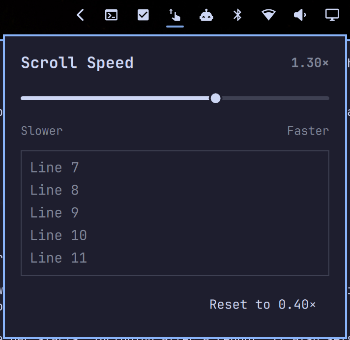

# Scroll Speed — Omarchy bar widget

A touchpad scroll speed slider that lives in your [Omarchy](https://omarchy.org) bar.
Click the icon, drag the slider, and scrolling speeds up or slows down right away.



- Drag the slider from 0.10× to 2.00× (Omarchy's default is 0.40×); the speed applies live while you drag
- Scroll in the box inside the panel to feel the speed without closing it
- Left/Right arrow keys nudge it in 0.05 steps
- **Reset** puts it back to Omarchy's default
- Colors and font come from your current Omarchy theme, so it matches every theme you switch to
- Your speed is saved to `~/.local/share/omarchy-scroll-speed/speed` and re-applied when the shell starts and whenever Hyprland reloads its config, so it survives reboots

It sets Hyprland's `input:touchpad:scroll_factor` with `hyprctl eval`. Omarchy's
per-app multipliers (e.g. faster scrolling in terminals) still apply on top.

## Install

```
omarchy plugin add https://github.com/SpaceLemonade/omarchy-scroll-speed-widget.git --enable
```

Move it along the bar by dragging, or with `omarchy bar move spacelemonade.scroll-speed --section left|center|right`.

## Update / remove

```
omarchy plugin update spacelemonade.scroll-speed
omarchy plugin remove spacelemonade.scroll-speed
```

Removing the widget leaves your current scroll speed in place until the next
Hyprland config reload or login, when your config's `scroll_factor` takes over again.

## License

MIT
